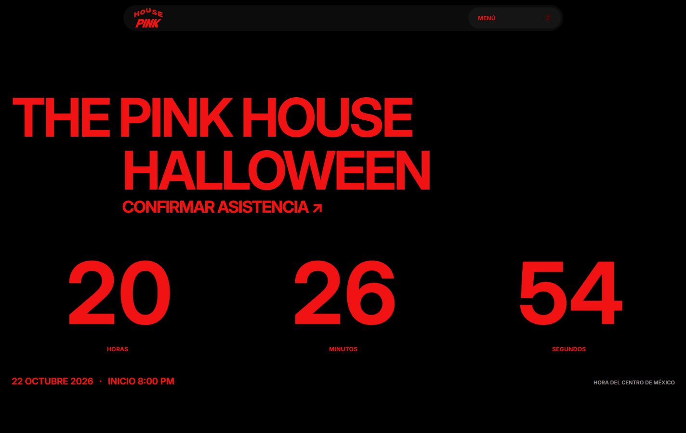
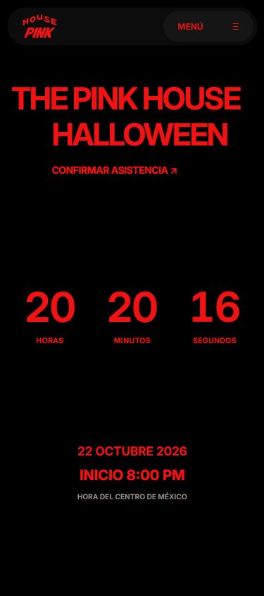
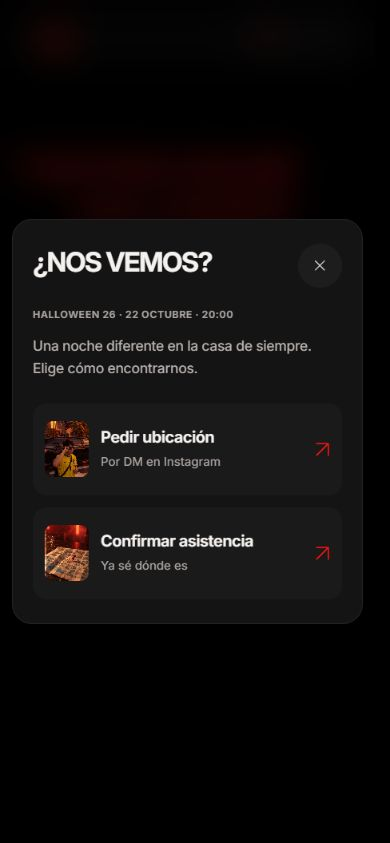

# Halloween: página simplificada

## Base verificada

Rama `codex/halloween-countdown`, creada desde `origin/main` en `35a10bdc1833b7e6890e15ecca7a0569f319b843`. La API de Cloudflare confirmó este mismo commit de `main` como despliegue canónico exitoso de `pink-house-page.pages.dev`. Se revisó la web publicada antes de editar.

La implementación vive en un worktree aislado. No utiliza los cambios locales pendientes del checkout principal, incluyendo el hero de boleto y su contador simulado.

## Experiencia

### Pulido móvil y modales

La última distribución móvil aprovecha la altura útil de la pantalla: encabezado más ancho en la parte superior, contador en el centro y fecha/hora en el bloque inferior. La fecha y la hora se presentan en dos líneas con más peso visual. La altura se adapta a la pantalla, conserva áreas seguras y permite scroll natural en horizontal. Revisado en 320×568, 375×667, 390×844, 430×932, 600×800, 844×390 y 1440×900; sin desbordamiento horizontal y todo el contenido visible en la primera pantalla en las vistas verticales.

Se eliminan la etiqueta «FALTAN PARA HALLOWEEN» y ambas líneas divisorias del contador y los datos del evento. La fecha, hora y zona horaria permanecen visibles sin separadores. En móvil el título y contador crecen, se reduce el espacio vacío superior y los datos se centran. Se contemplan pantallas bajas, orientación horizontal y áreas seguras.

Los modales usan superficies oscuras neutras, títulos claros, tarjetas sin contornos y botones de cierre de 44 px. El menú pierde el contorno rojo de sus controles y conserva todas sus funciones. El ticket redistribuye su ilustración encima de los datos en pantallas pequeñas para mejorar la lectura.

Revisión adicional de página, asistencia y menú en 320×568, 375×667, 390×844, 600×800, 768×1024, 844×390 y 1440×900: sin desbordamiento horizontal, diálogos dentro del viewport, destinos válidos y retorno del foco al cerrar con Escape. En horizontal bajo se permite desplazamiento vertical natural.

La página conserva `OpeningCollage`, el header flotante original, el logo publicado, la paleta negra/roja y la composición THE PINK HOUSE / HALLOWEEN con su botón de asistencia. Debajo muestra un único contador grande de horas totales, minutos y segundos y la fecha con INICIO 8:00 PM, hora del centro de México.

El destino es `2026-10-22T20:00:00-06:00` (`2026-10-23T02:00:00Z`), independiente de la zona horaria del visitante. Se recalcula desde el reloj al volver a la pestaña o recargar; no reinicia y se limita a cero después del inicio.

El menú navega a `#top`, `#countdown` y `#event-start`. Conserva los modales de asistencia, agenda y ticket interactivo, más Instagram. Se retiran los enlaces a secciones eliminadas. Las fotografías, secciones editoriales, video, archivo, globo, footer y barra inferior no se montan en el recorrido; sus fuentes y assets permanecen disponibles.

## Validación

- `npm run typecheck`, `npm test` (47 pruebas) y `npm run build`: correctos.
- Las seis pruebas nuevas cubren destino y zona horaria, horas totales superiores a 24/99, transiciones, fracciones de segundo, recarga y cero al vencer.
- Navegador sobre el build: 320 × 568, 390 × 844, 768 × 1024, 1266 × 712 y 1440 × 900. Sin desbordamiento horizontal; contador y hora de inicio dentro de la primera pantalla en esos tamaños.
- Navegación a la cuenta regresiva y existencia de todos los destinos del menú; apertura de asistencia desde el menú; enlaces originales de Instagram y calendario presentes.
- Apertura y cierre de agenda y ticket; Enter en las tijeras abre el plan; Escape cierra el modal y devuelve el foco al menú.
- El header y la animación de entrada originales conservan su comportamiento para movimiento reducido.

## Capturas del build

El contador refleja el momento de la captura y continúa actualizándose en la web.

